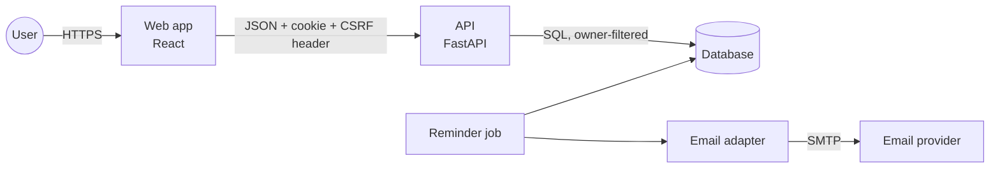
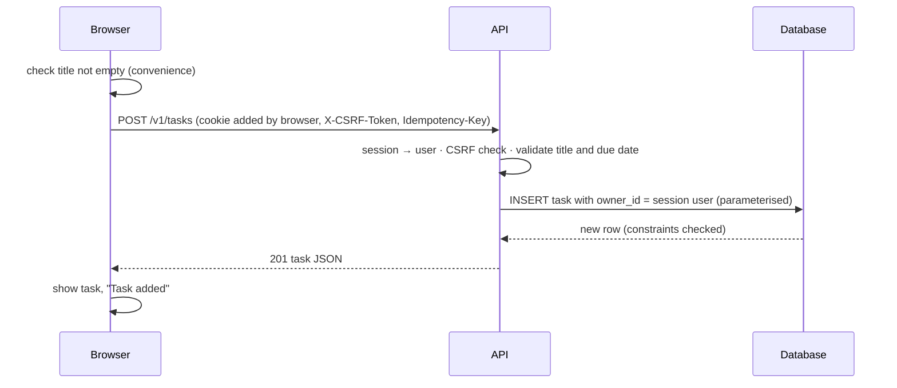
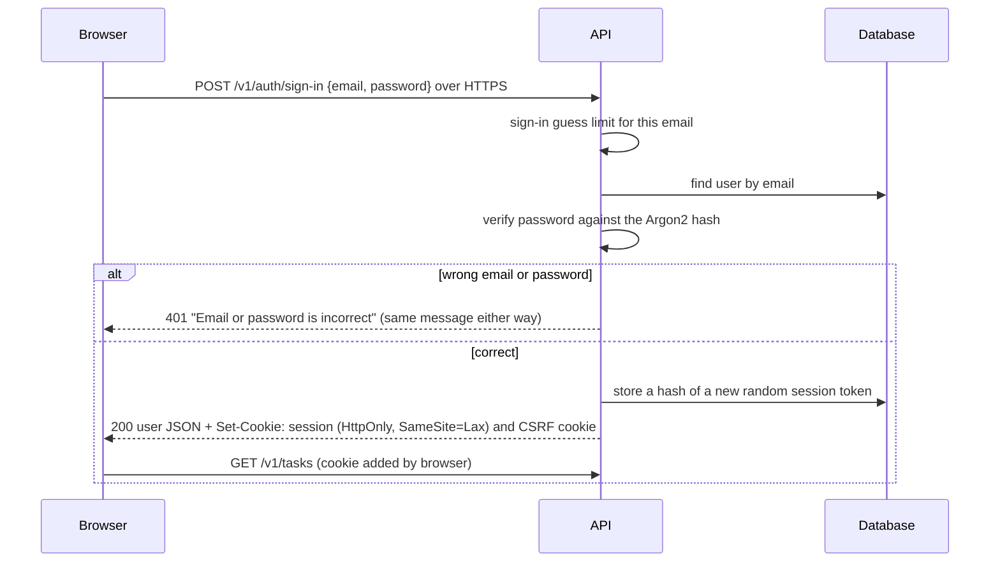

# Architecture

## Components (C4 container view)



**Trust boundary:** everything arriving at the API from the browser or a webhook is untrusted:
it is authenticated (session), checked (CSRF on changes), validated, and authorised (owner)
before anything touches the database.

## Creating a task



## Signing in



## Retrieving tasks later

```mermaid
sequenceDiagram
  participant B as Browser
  participant A as API
  participant D as Database
  B->>B: show loading rows
  B->>A: GET /v1/tasks?status=open (session cookie)
  A->>D: look up the session by token hash → user
  A->>D: SELECT … WHERE owner_id = user AND is_done = false (index on owner_id, is_done, due_date)
  D-->>A: rows, soonest due first, undated last
  A-->>B: 200 {items, next_cursor}
  B->>B: show the list; overdue tasks marked with icon and text
```
