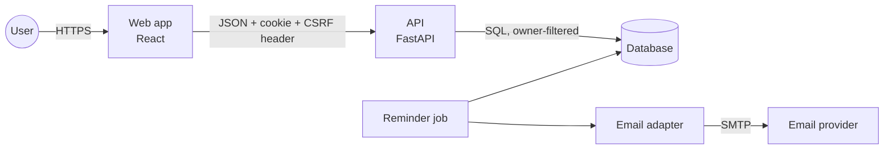
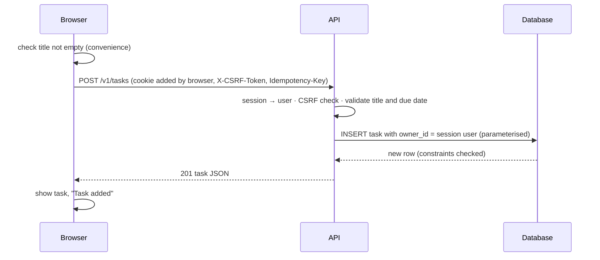

# Architecture

## Components (C4 container view)

**Trust boundary:** everything arriving at the API from the browser or a webhook is untrusted:
it is authenticated (session), checked (CSRF on changes), validated, and authorised (owner)
before anything touches the database.

## Creating a task

